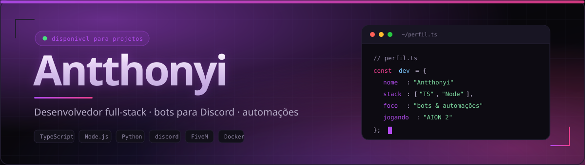
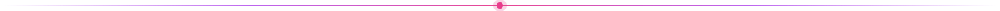
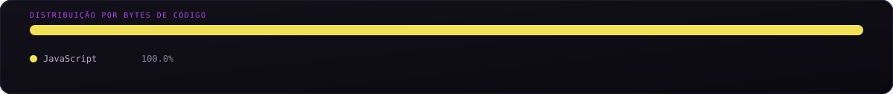
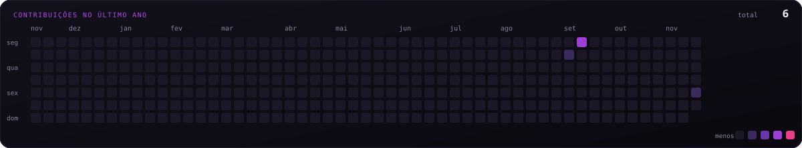
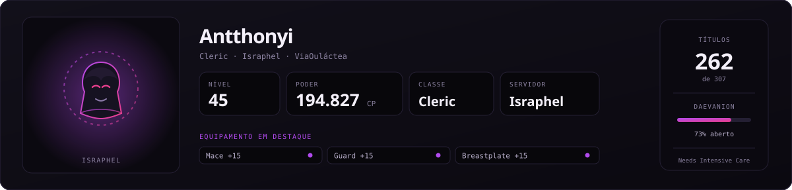

<!-- ============================================================
     Antthonyi · perfil do GitHub
     Paleta: #08070b fundo · #b14aed roxo · #e83e8c rosa
     Os gráficos são gerados pelo workflow em .github/workflows/
     ============================================================ -->

 

 

##  &nbsp; Tecnologias

<table>
<tr><td width="33%" valign="top">

**Frontend**
`TypeScript` `React` `Next.js`
`Tailwind` `Vite` `HTML/CSS`

</td><td width="33%" valign="top">

**Backend & Bots**
`Node.js` `discord.js` `Python`
`FastAPI` `REST` `SQLite`

</td><td width="34%" valign="top">

**Infra & Extras**
`Docker` `Linux` `Git`
`Nginx` `CI/CD` `FiveM`

</td></tr>
</table>

##  &nbsp; Linguagens usadas

##  &nbsp; Gráficos

 

 

##  &nbsp; Onde já trabalhei

<table>
<tr>
<td width="33%" valign="top" align="center">

### Liberdade RP
FiveM

Sistemas e scripts para servidor de GTA RP.

</td>
<td width="33%" valign="top" align="center">

### Legion RP
FiveM

Automações internas, integrações e ferramentas de staff.

</td>
<td width="34%" valign="top" align="center">

### Bahamas RP
FiveM

Scripts, painéis e apoio à comunidade do servidor.

</td>
</tr>
</table>

##  &nbsp; Fora do código

Animes · AION 2 · Roblox · bots para Discord
  

